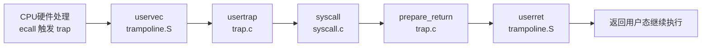

<div style="max-width: 620px; margin: 56px auto; font-family: 'Noto Serif SC','Songti SC',Georgia,serif; color: light-dark(#2b2b2b, #d1d5db); line-height: 2;">

<p style="font-size: 11px; letter-spacing: .5em; text-transform: uppercase; color: light-dark(#888, #9aa3b2); margin: 0 0 24px;">Preface</p>

<div style="width: 36px; height: 1px; background: light-dark(#111, #e1e6ed); margin-bottom: 34px;"></div>

<p style="font-size: 15px; text-align: justify; text-justify: inter-ideograph; margin: 0 0 18px;">

系统调用的流程到底是怎样的？

</p>

<p style="font-size: 13px; color: light-dark(#888, #9aa3b2); letter-spacing: .1em; text-align: right; margin: 40px 0 0;">— 2026/11/13</p>

</div>

# Lab System calls

本 Lab 主要以完成 `interpose` 为例，让读者了解 xv6 中系统调用的全流程

## 用户接口

以 interpose 为例子

我们会在用户层提供接口 `interpose(int syscall,char* name)`，
这个接口的由汇编完成实现，汇编代码由 `usys.pl` 自动生成，我们只需要在 `usys.pl` 中添加 `entry("interpose")` 即可
生成的汇编如下：

```asm
.global interpose # 外部链接interpose，表示对interpose函数的实现
interpose:
   li a7, SYS_interpose # li表示load immediate，加载立即数到a7寄存器中
   ecall # 触发系统调用
   ret # 返回
```

需要说明的是，`ecall` 就相当于 x86 中的 `syscall`，而系统调用号是被放在 a7 中。

## RISC-V

后续会涉及到 RISC-V 汇编知识，让我们简单了解一下相关知识
寄存器

- <u>**zero**</u> 硬接线为 0，表示值恒为 0
- <u>**ra**</u> Return Address 用于存放返回地址
- <u>**sp**</u> Stack Pointer 栈指针
- <u>**a0~a7**</u> 存放整数参数，多余参数由调用者压栈，返回值保存在 a0

> 在 `ecall` 时，a0~a5 用于从存放参数，a7 用于放系统调用号，返回值存在 a0

RISC-V 与 x86 一个显著的区别就是有个特殊的 ra 寄存器存放返回地址，当一个函数调用另一个函数时，会将 `ra` 保存起来

本 lab 关于 RISC-V 学习到这儿就足够了

## syscall

当使用 `ecall` 之后会发生什么呢？

ecall 属于 trap 的一种，主要分为四个步骤

### CPU 硬件执行原子操作

CPU 做的事情主要是更改 pc，改变硬件控制寄存器（Hardware control registers）和改变特权级，硬件控制寄存器有许多个

1. 将 `pc` 中的值保存到 `sepc`（Supervisor Exception Program Counter），保存函数调用后能返回到正确的位置

2. 记录 trap 的原因，在 `scause`（Supervisor Cause）写入一个数字，表明 trap 原因，因为 trap 不仅限于系统调用

3. 关闭中断，改变 `sstatus`（Supervisor Status），禁用中断，防止处理系统调用时被打断

4. 在 `sstatus` 中写入当前特权级，以便返回时后续该回到哪个权级

5. 改变特权级，将当前 CPU 的特权级设置为 Supervisor mode

6. 跳转 将 pc 设置为 `stvec` 寄存器中预先配置好的地址，这个地址式 Trap handler 的入口

### 汇编层的软件处理

`stvec` 中的跳转地址已被内核修改为 `uservec` 的地址，`uservec` 位于 `trampoline.S` 文件中
实现如下：

```
uservec:    

        # trap.c sets stvec to point here, so
        # traps from user space start here,
        # in supervisor mode, but with a
        # user page table.
        #

        # save user a0 in sscratch so
        # a0 can be used to get at TRAPFRAME.
        csrw sscratch, a0

        # each process has a separate p->trapframe memory area,
        # but it's mapped to the same virtual address
        # (TRAPFRAME) in every process's user page table.
        li a0, TRAPFRAME
        
        # save the user registers in TRAPFRAME
        sd ra, 40(a0)
        sd sp, 48(a0)
        sd gp, 56(a0)
        sd tp, 64(a0)
        sd t0, 72(a0)
        sd t1, 80(a0)
        sd t2, 88(a0)
        sd s0, 96(a0)
        sd s1, 104(a0)
        sd a1, 120(a0)
        sd a2, 128(a0)
        sd a3, 136(a0)
        sd a4, 144(a0)
        sd a5, 152(a0)
        sd a6, 160(a0)
        sd a7, 168(a0)
        sd s2, 176(a0)
        sd s3, 184(a0)
        sd s4, 192(a0)
        sd s5, 200(a0)
        sd s6, 208(a0)
        sd s7, 216(a0)
        sd s8, 224(a0)
        sd s9, 232(a0)
        sd s10, 240(a0)
        sd s11, 248(a0)
        sd t3, 256(a0)
        sd t4, 264(a0)
        sd t5, 272(a0)
        sd t6, 280(a0)

	# save the user a0 in p->trapframe->a0
        csrr t0, sscratch
        sd t0, 112(a0)

        # initialize kernel stack pointer, from p->trapframe->kernel_sp
        ld sp, 8(a0)

        # make tp hold the current hartid, from p->trapframe->kernel_hartid
        ld tp, 32(a0)

        # load the address of usertrap(), from p->trapframe->kernel_trap
        ld t0, 16(a0)

        # fetch the kernel page table address, from p->trapframe->kernel_satp.
        ld t1, 0(a0)

        # wait for any previous memory operations to complete, so that
        # they use the user page table.
        sfence.vma zero, zero

        # install the kernel page table.
        csrw satp, t1

        # flush now-stale user entries from the TLB.
        sfence.vma zero, zero

        # call usertrap()
        jalr t0
```

`trapframe` 实现

```C
struct trapframe {
  /*   0 */ uint64 kernel_satp;   // kernel page table
  /*   8 */ uint64 kernel_sp;     // top of process's kernel stack
  /*  16 */ uint64 kernel_trap;   // usertrap()
  /*  24 */ uint64 epc;           // saved user program counter
  /*  32 */ uint64 kernel_hartid; // saved kernel tp
  /*  40 */ uint64 ra;
  /*  48 */ uint64 sp;
  /*  56 */ uint64 gp;
  /*  64 */ uint64 tp;
  /*  72 */ uint64 t0;
  /*  80 */ uint64 t1;
  /*  88 */ uint64 t2;
  /*  96 */ uint64 s0;
  /* 104 */ uint64 s1;
  /* 112 */ uint64 a0;
  /* 120 */ uint64 a1;
  /* 128 */ uint64 a2;
  /* 136 */ uint64 a3;
  /* 144 */ uint64 a4;
  /* 152 */ uint64 a5;
  /* 160 */ uint64 a6;
  /* 168 */ uint64 a7;
  /* 176 */ uint64 s2;
  /* 184 */ uint64 s3;
  /* 192 */ uint64 s4;
  /* 200 */ uint64 s5;
  /* 208 */ uint64 s6;
  /* 216 */ uint64 s7;
  /* 224 */ uint64 s8;
  /* 232 */ uint64 s9;
  /* 240 */ uint64 s10;
  /* 248 */ uint64 s11;
  /* 256 */ uint64 t3;
  /* 264 */ uint64 t4;
  /* 272 */ uint64 t5;
  /* 280 */ uint64 t6;
};
```

`sd`（Store Doubleword）表示将寄存器中值存到指定内存中去

`uservec` 所做的事情：

- **保存用户寄存器到 `trapframe` 中** `trapframe` 是进程虚拟内存空间的一个特殊区域，专门保存 trap 时的用户寄存器
- **切换到内核栈** 将 `sp` 设置为当前进程的内核栈

> 内核栈不同于用户栈，用户栈是在当前进程的虚拟地址空间当中。每个进程都有自己的内核栈，但内核栈属于内核虚拟地址空间，内核地址空间有所有进程共享。在 `proc` 中 `kstack` 字段专门存放内核栈的虚拟地址

- **切换内核页表** 将 `satp` 设置为内核页表的地址

> 内核页表是全局变量，定义在 `vm.c` 中
    ```
    pagetable_t kernel_pagetable;
    ```
    这个页表映射内核代码，内核数据，每个进程的 `trapframe` 等等。每个进程都有独立的内核栈，但都映射到同一个内核页表中

- **跳转到 C 代码** 从 `uservec` 跳转到 `usertrap()` 函数

### C 的软件处理

`usertrap()` 是内核中处理用户态 Trap 的核心 C 函数，位于 `kernel/trap.c`

```C
uint64 usertrap(void)
{
  int which_dev = 0;

  if ((r_sstatus() & SSTATUS_SPP) != 0)
    panic("usertrap: not from user mode");

  // send interrupts and exceptions to kerneltrap(),
  // since we're now in the kernel.
  w_stvec((uint64)kernelvec); //DOC: kernelvec

  struct proc *p = myproc();

  // save user program counter.
  p->trapframe->epc = r_sepc();

  if (r_scause() == 8) {
    // system call

    if (killed(p))
      kexit(-1);

    // sepc points to the ecall instruction,
    // but we want to return to the next instruction.
    p->trapframe->epc += 4;

    // an interrupt will change sepc, scause, and sstatus,
    // so enable only now that we're done with those registers.
    intr_on();

    syscall();
  } else if ((which_dev = devintr()) != 0) {
    // ok
  } else if ((r_scause() == 15 || r_scause() == 13) &&
             vmfault(p->pagetable, p->sz, r_stval(),
                     (r_scause() == 13) ? 1 : 0) != 0) {
    // page fault on lazily-allocated page
  } else {
    printk("usertrap(): unexpected scause 0x%lx pid=%d\n", r_scause(), p->pid);
    printk("            sepc=0x%lx stval=0x%lx\n", r_sepc(), r_stval());
    setkilled(p);
  }

  if (killed(p))
    kexit(-1);

  // give up the CPU if this is a timer interrupt.
  if (which_dev == 2)
    yield();

  prepare_return();

  // the user page table to switch to, for trampoline.S
  uint64 satp = MAKE_SATP(p->pagetable);

  // return to trampoline.S; satp value in a0.
  return satp;
}
```

`usertrap` 所做的事情

- **将 `sepc` 中的返回地址保存到 `trapframe`** 不依赖寄存器长期保存地址。此外若为系统调用，还要将 `epc += 4`，这是因为，`sepc` 存的是 `ecall` 之前 `pc` 中的值，`pc` 保存下一条指令的地址，也就是 `ecall`，但我们想要的是系统调用返回后执行 `ecall` 的下一条指令，因此偏移 4 个字节

> 至于为什么是加 4，而不是加 8，这是因为 `ecall` 指令占 4 个字节

- **重启系统中断** 调用 `intr_on()` 函数重启中断
- **分发处理** 依据 `scause` 中的值判断 trap 的原因，并进行相应处理，对于系统调用，并调用 `syscall` 函数

> 除了系统调用，还可能是设备中断（Device Interrupt）或者异常（Exception），Expcetion 时，usertrap 会打印错误信息（包括 scause,sepc,stval 等）

### `syscall` 分发系统调用

`syscall()` 位于 `kernel/syscall.c`

```C
void syscall(void)
{
  int num;
  struct proc *p = myproc();

  num = p->trapframe->a7;
  if (num > 0 && num < NELEM(syscalls) && syscalls[num]) {
    // Use num to lookup the system call function for num, call it,
    // and store its return value in p->trapframe->a0
    p->trapframe->a0 = syscalls[num]();
  } else {
    printk("%d %s: unknown sys call %d\n", p->pid, p->name, num);
    p->trapframe->a0 = -1;
  }
}
```

其功能显而易见，读取 `a7` 中系统调用号，分发系统调用，并保存返回值到 `a0` 寄存器中

那么系统调用处理函数怎么工作呢？

在开始是我们在用户层定义了 `interpose` 函数接口

在调用 `interpose` 接口函数时，有两个参数被传入，根据函数调用约定，这个两个参数被存放在寄存器 `a0` 和 `a1` 中，然后这两个参数在汇编处理阶段被存入 `trapframe` 中，所以在具体实现中，我们需要去 `trapframe` 中找这两个参数

好消息是，在 `kernel/syscall.c` 为我们提供了相关接口获取参数 `argraw` 极其衍生函数，如 `argint` 和 `argstr`

### 返回用户态

在 `syscall` 函数完毕后，进入 `prepare_return()` 函数

```C
void prepare_return(void)
{
  struct proc *p = myproc();

  // we're about to switch the destination of traps from
  // kerneltrap() to usertrap(). because a trap from kernel
  // code to usertrap would be a disaster, turn off interrupts.
  intr_off();

  // send syscalls, interrupts, and exceptions to uservec in trampoline.S
  uint64 trampoline_uservec = TRAMPOLINE + (uservec - trampoline);
  w_stvec(trampoline_uservec);

  // set up trapframe values that uservec will need when
  // the process next traps into the kernel.
  p->trapframe->kernel_satp = r_satp();         // kernel page table
  p->trapframe->kernel_sp = p->kstack + PGSIZE; // process's kernel stack
  p->trapframe->kernel_trap = (uint64)usertrap;
  p->trapframe->kernel_hartid = r_tp(); // hartid for cpuid()

  // set up the registers that trampoline.S's sret will use
  // to get to user space.

  // set S Previous Privilege mode to User.
  unsigned long x = r_sstatus();
  x &= ~SSTATUS_SPP; // clear SPP to 0 for user mode
  x |= SSTATUS_SPIE; // enable interrupts in user mode
  w_sstatus(x);

  // set S Exception Program Counter to the saved user pc.
  w_sepc(p->trapframe->epc);
}
```

`prepare` 重新关闭中断；修改 `stvec` 为 trap 入口，保证下次 trap 时正常进入 `uservec`；调整 `trapframe` 的内核信息；修改 `sstatus`。最后在 `usertrap` 中返回 `satp`

`usertrap` 返回在 `userret` 中
`userret` 实现如下

```
userret:
        # usertrap() returns here, with user satp in a0.
        # return from kernel to user.

        # flush icache, in case this is the first time
        # we're running this proc on this hart.
        fence.i

        # switch to the user page table.
        sfence.vma zero, zero
        csrw satp, a0
        sfence.vma zero, zero

        li a0, TRAPFRAME

        # restore all but a0 from TRAPFRAME
        ld ra, 40(a0)
        ld sp, 48(a0)
        ld gp, 56(a0)
        ld tp, 64(a0)
        ld t0, 72(a0)
        ld t1, 80(a0)
        ld t2, 88(a0)
        ld s0, 96(a0)
        ld s1, 104(a0)
        ld a1, 120(a0)
        ld a2, 128(a0)
        ld a3, 136(a0)
        ld a4, 144(a0)
        ld a5, 152(a0)
        ld a6, 160(a0)
        ld a7, 168(a0)
        ld s2, 176(a0)
        ld s3, 184(a0)
        ld s4, 192(a0)
        ld s5, 200(a0)
        ld s6, 208(a0)
        ld s7, 216(a0)
        ld s8, 224(a0)
        ld s9, 232(a0)
        ld s10, 240(a0)
        ld s11, 248(a0)
        ld t3, 256(a0)
        ld t4, 264(a0)
        ld t5, 272(a0)
        ld t6, 280(a0)

	# restore user a0
        ld a0, 112(a0)
        
        # return to user mode and user pc.
        # prepare_return() sets up sstatus and sepc.
        sret
```

基本就是在将 trapframe 中的值重新写入寄存器中，最后 `sret` 返回，硬件自动将特权级切换至 User Mode.

整体调用链：



这便是系统调用的全流程
